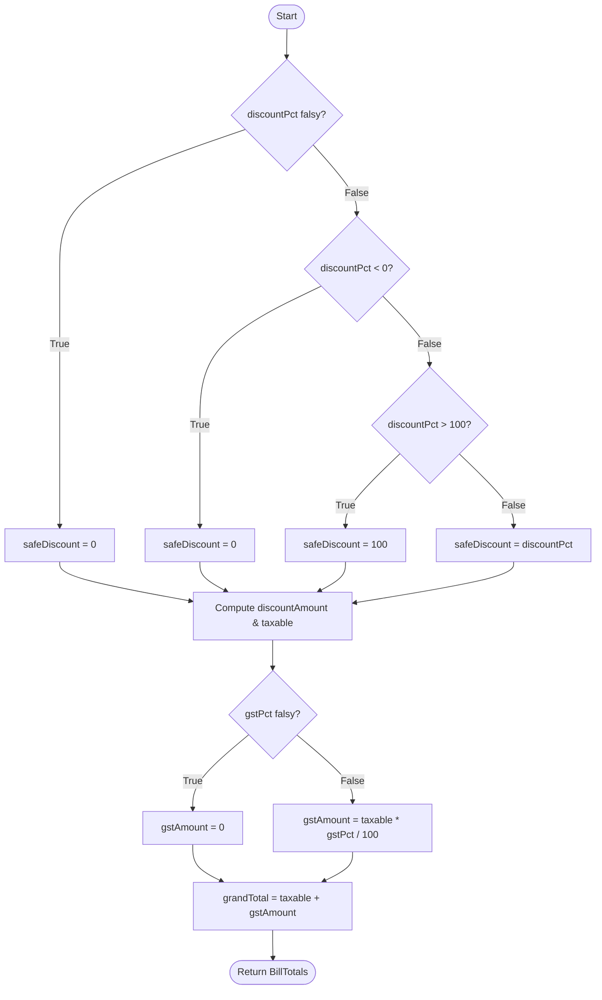
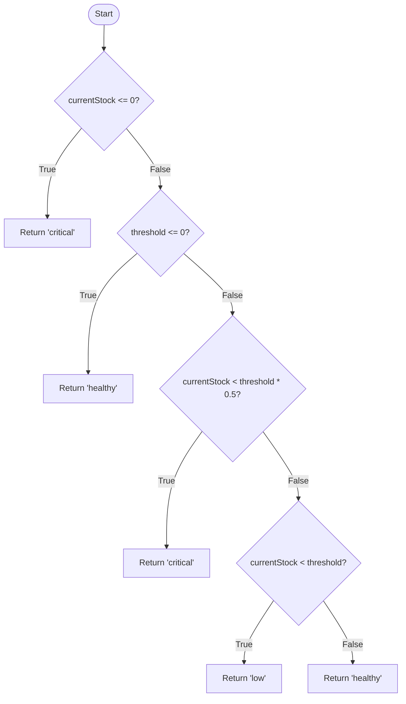
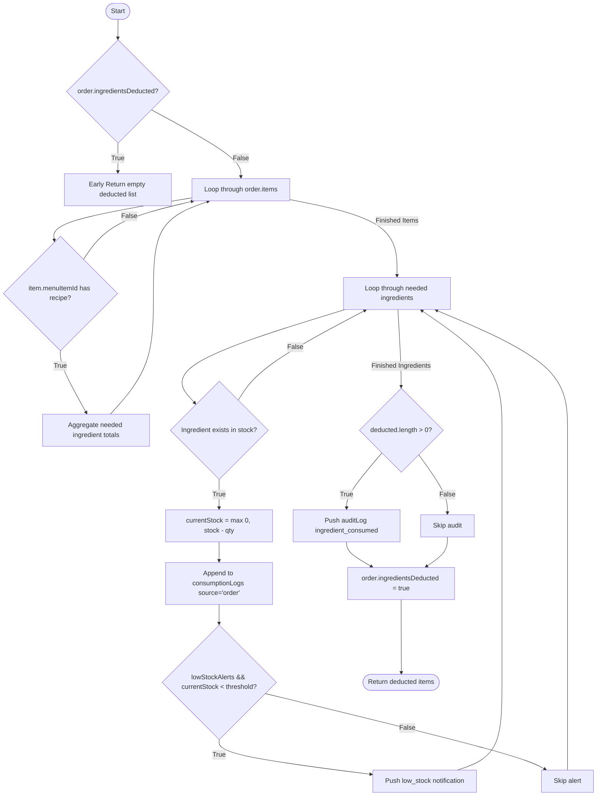

# White Box Testing Specification Document
**Project:** Restaurant Automation System (RAS)  
**Subject:** Software Architecture & Design (SAD) Lab  
**Test Suite:** Structural & White Box Test Suite  
**Execution Engine:** Vitest v4 / jsdom  

---

## 1. Introduction & White Box Testing Methodology

White Box Testing (also termed Glass Box, Clear Box, or Structural Testing) is a software testing methodology where the internal structure, control flow paths, branch decisions, and logic conditions of the application's source code are directly tested.

This test specification covers four primary white-box testing criteria:
1. **Statement Coverage ($C_0$):** Every executable line of code and statement is traversed at least once.
2. **Branch / Decision Coverage ($C_1$):** Every decision branch (e.g., `if-then-else`, ternary `?:`, logical short-circuits `&&` / `||`) is evaluated to both `true` and `false`.
3. **Multiple Condition Coverage (MCC):** Every atomic boolean condition within compound expressions is evaluated independently to `true` and `false`.
4. **Basis Path Testing (McCabe's Cyclomatic Complexity):** Independent linear execution paths are derived using Control Flow Graphs (CFG) where:
   $$V(G) = E - N + 2P$$
   or
   $$V(G) = \text{Predicate Nodes} + 1$$
   *(where $E$ = edges, $N$ = nodes, $P$ = connected components)*

---

## 2. Control Flow Graphs (CFG) & Cyclomatic Complexity Analysis

### 2.1 Function: `computeBillTotals(subtotal, discountPct, gstPct)`

#### Source Logic:
```typescript
const safeDiscount = Math.max(0, Math.min(100, discountPct || 0));
const discountAmount = round2((subtotal * safeDiscount) / 100);
const taxable = round2(subtotal - discountAmount);
const gstAmount = round2((taxable * (gstPct || 0)) / 100);
const grandTotal = round2(taxable + gstAmount);
return { subtotal: round2(subtotal), discountAmount, taxable, gstAmount, grandTotal };
```

#### Control Flow Graph (CFG):


- **Predicates:** 4 (`discountPct` falsy, `< 0`, `> 100`, `gstPct` falsy)
- **Cyclomatic Complexity:** $V(G) = 4 + 1 = 5$
- **Independent Basis Paths:**
  - **Path 1 (Standard):** valid discount $0 < d < 100$, valid GST $\rightarrow$ normal total calculated.
  - **Path 2 (Negative Discount):** $d < 0 \rightarrow$ clamped to $0\%$.
  - **Path 3 (Excessive Discount):** $d > 100 \rightarrow$ clamped to $100\%$.
  - **Path 4 (Falsy Discount):** $d \in \{0, \text{NaN}, \text{undefined}\} \rightarrow$ treated as $0\%$.
  - **Path 5 (Falsy GST):** $\text{gst} \in \{0, \text{NaN}\} \rightarrow$ GST is $0$.

---

### 2.2 Function: `stockStatus(currentStock, threshold)`

#### Source Logic:
```typescript
if (currentStock <= 0) return "critical";
if (threshold <= 0) return "healthy";
if (currentStock < threshold * 0.5) return "critical";
if (currentStock < threshold) return "low";
return "healthy";
```

#### Control Flow Graph (CFG):


- **Nodes ($N$):** 10
- **Edges ($E$):** 13
- **Cyclomatic Complexity:** $V(G) = 13 - 10 + 2 = 5$
- **Basis Paths:**
  - **Path 1:** $N1 \rightarrow N2 \rightarrow N3$ (`currentStock <= 0`) $\rightarrow$ `"critical"`
  - **Path 2:** $N1 \rightarrow N2 \rightarrow N4 \rightarrow N5$ (`threshold <= 0`) $\rightarrow$ `"healthy"`
  - **Path 3:** $N1 \rightarrow N2 \rightarrow N4 \rightarrow N6 \rightarrow N7$ (`stock < 0.5 * threshold`) $\rightarrow$ `"critical"`
  - **Path 4:** $N1 \rightarrow N2 \rightarrow N4 \rightarrow N6 \rightarrow N8 \rightarrow N9$ (`0.5 * threshold <= stock < threshold`) $\rightarrow$ `"low"`
  - **Path 5:** $N1 \rightarrow N2 \rightarrow N4 \rightarrow N6 \rightarrow N8 \rightarrow N10$ (`stock >= threshold`) $\rightarrow$ `"healthy"`

---

### 2.3 Function: `deductOrderIngredients(d, order, actorId)`

#### Control Flow Graph (CFG):


- **Predicates:** 6 (`ingredientsDeducted`, `has recipe`, `ingredient exists`, `lowStockAlerts && stock < threshold`, `deducted > 0`)
- **Cyclomatic Complexity:** $V(G) = 6 + 1 = 7$

---

## 3. Master White Box Test Cases Table

| Test Case ID | Target Function / Module | Test Objective | Path / Condition Under Test | Test Inputs | Expected Result | Status |
| :--- | :--- | :--- | :--- | :--- | :--- | :--- |
| **WBT-BILL-001** | `computeBillTotals` | Standard calculation | Normal discount & GST paths | subtotal: 1000, discount: 10%, gst: 5% | discount: 100, taxable: 900, gst: 45, total: 945 | **PASS** |
| **WBT-BILL-002** | `computeBillTotals` | Negative discount boundary | Clamping `Math.max(0, ...)` | subtotal: 500, discount: -15%, gst: 10% | discount: 0, taxable: 500, total: 550 | **PASS** |
| **WBT-BILL-003** | `computeBillTotals` | Excessive discount boundary | Clamping `Math.min(100, ...)` | subtotal: 800, discount: 120%, gst: 18% | discount: 800, taxable: 0, gst: 0, total: 0 | **PASS** |
| **WBT-BILL-004** | `computeBillTotals` | Falsy input fallback | `discountPct \|\| 0`, `gstPct \|\| 0` | subtotal: 400, discount: NaN, gst: 5% | discount: 0, taxable: 400, total: 420 | **PASS** |
| **WBT-BILL-005** | `computeBillTotals` | Fractional precision & rounding | Rounding to 2 decimal places | subtotal: 333.33, discount: 7.5%, gst: 18% | discount: 25.00, taxable: 308.33, total: 363.83 | **PASS** |
| **WBT-BILL-006** | `round2` | Decimal precision boundary | Values around `.005` boundaries | `10.234`, `10.235`, `0`, `-4.555` | `10.23`, `10.24`, `0`, `-4.55` | **PASS** |
| **WBT-BILL-007** | `sumPayments` | Empty payments handling | `payments.length === 0` | `[]` | `0` | **PASS** |
| **WBT-BILL-008** | `paymentGap` | Multi-tender exact match | `grandTotal - sum(payments) === 0` | payments: [Cash 250, UPI 250], total: 500 | gap: `0` | **PASS** |
| **WBT-BILL-009** | `paymentGap` | Underpaid tender calculation | `grandTotal > sum(payments)` | payments: [Card 300], total: 450 | gap: `150` | **PASS** |
| **WBT-BILL-010** | `paymentGap` | Overpaid tender (Change due) | `grandTotal < sum(payments)` | payments: [Cash 600], total: 500 | gap: `-100` | **PASS** |
| **WBT-BILL-011** | `paymentAffectsCashDrawer` | Tender classification (Cash) | `mode === 'cash'` | mode: `"cash"` | `true` | **PASS** |
| **WBT-BILL-012** | `paymentAffectsCashDrawer` | Tender classification (Non-cash)| `mode !== 'cash'` | mode: `"upi"`, `"card"` | `false` | **PASS** |
| **WBT-INV-001** | `stockStatus` | Zero/negative stock path | `currentStock <= 0` | stock: 0, threshold: 10; stock: -2.5, threshold: 10 | `"critical"` | **PASS** |
| **WBT-INV-002** | `stockStatus` | Zero threshold path | `threshold <= 0 && stock > 0` | stock: 5, threshold: 0; stock: 10, threshold: -5 | `"healthy"` | **PASS** |
| **WBT-INV-003** | `stockStatus` | Critical depletion boundary | `stock < threshold * 0.5` | stock: 9.9, threshold: 20 (50% = 10) | `"critical"` | **PASS** |
| **WBT-INV-004** | `stockStatus` | 50% boundary check | `stock === threshold * 0.5` | stock: 10, threshold: 20 | `"low"` | **PASS** |
| **WBT-INV-005** | `stockStatus` | Intermediate low stock | `0.5 * th <= stock < th` | stock: 10.1, threshold: 20; stock: 19.99, threshold: 20 | `"low"` | **PASS** |
| **WBT-INV-006** | `stockStatus` | Threshold boundary check | `stock === threshold` | stock: 20, threshold: 20 | `"healthy"` | **PASS** |
| **WBT-INV-007** | `stockStatus` | Surplus healthy stock | `stock > threshold` | stock: 20.01, threshold: 20; stock: 50, threshold: 20 | `"healthy"` | **PASS** |
| **WBT-INV-008** | `averageDailyConsumption` | Filtering by ingredient & date window | Logs before cutoff, on cutoff, in window, on today, in future | 6 logs with varying dates & ingredients, window: 3 | sum(10, 15, 5)/3 = `10` | **PASS** |
| **WBT-INV-009** | `averageDailyConsumption` | Empty / Non-matching logs | `logs.length === 0` | empty array or mismatched ingredientId | `0` | **PASS** |
| **WBT-INV-010** | `computeThreshold` | Coverage days formula path | `avgDaily * settings.coverageDays` | logs sum: 45 over 3 days (avg=15), coverage: 2.5 | avgDaily: 15, threshold: `37.5` | **PASS** |
| **WBT-PO-001** | `hasSameDayPO` | Date mismatch path | `po.date !== today` | PO date: "2026-11-01", target date: "2026-11-02" | `false` | **PASS** |
| **WBT-PO-002** | `hasSameDayPO` | Ingredient mismatch path | `line.ingredientId !== target` | PO with "ing-other", target: "ing-1" | `false` | **PASS** |
| **WBT-PO-003** | `hasSameDayPO` | Exact match path | Same date and ingredient present | PO date: "2026-11-02", line has "ing-1" | `true` | **PASS** |
| **WBT-PO-004** | `computeReorderPlan` | Sufficient stock bypass | `ing.currentStock >= threshold` | currentStock: 20, threshold: 10 | Line omitted from plan | **PASS** |
| **WBT-PO-005** | `computeReorderPlan` | Same-day duplicate bypass | `hasSameDayPO === true` | same-day PO exists for depleted ingredient | Line omitted from plan | **PASS** |
| **WBT-PO-006** | `computeReorderPlan` | Pack size multiple ceiling | `Math.ceil(req / pack) * pack` | required: 16, packSize: 10 | orderQty: `20`, cost: `1000` | **PASS** |
| **WBT-PO-007** | `computeReorderPlan` | Non-positive packSize fallback | `packSize <= 0 ? 1 : packSize` | required: 3.5, packSize: 0 | orderQty: `4` | **PASS** |
| **WBT-PO-008** | `groupReorderBySupplier` | Multi-supplier grouping path | Map aggregation by supplierId | 3 lines across 2 suppliers (sup-A: 2, sup-B: 1) | 2 groups generated | **PASS** |
| **WBT-PO-009** | `groupReorderBySupplier` | Empty lines path | `lines.length === 0` | `[]` | `[]` | **PASS** |
| **WBT-DED-001** | `orderTotal` | Empty order items | `order.items.length === 0` | items: `[]` | `0` | **PASS** |
| **WBT-DED-002** | `orderTotal` | Fractional price summation | $\sum (\text{qty} \times \text{price})$ | items: [2 x 250, 3 x 75.5] | `726.5` | **PASS** |
| **WBT-DED-003** | `deductOrderIngredients` | Recipe multi-item aggregation | Multiple dishes sharing ingredients | 2 Paneer Tikka + 4 Butter Naan | Butter: -0.3kg, Paneer: -0.4kg | **PASS** |
| **WBT-DED-004** | `deductOrderIngredients` | Idempotency guard check | `order.ingredientsDeducted === true` | Order previously deducted | No stock change, returns `[]` | **PASS** |
| **WBT-DED-005** | `deductOrderIngredients` | Deficit floor clamping | `Math.max(0, stock - qty)` | stock: 0.1kg, needed: 0.3kg | stock clamped to `0` (not -0.2) | **PASS** |
| **WBT-DED-006** | `deductOrderIngredients` | Low stock alert dispatch | `alerts=true && stock < threshold` | stock drops from 1.7 to 1.3 (threshold 1.5) | `low_stock` notification pushed | **PASS** |
| **WBT-DED-007** | `deductOrderIngredients` | Low stock alert suppression | `alerts=false` | stock drops below threshold with alerts off | No notification pushed | **PASS** |
| **WBT-ACT-001** | `cashBalance` | Empty cash book | `cashBook.length === 0` | empty cashBook | `0` | **PASS** |
| **WBT-ACT-002** | `cashBalance` | Non-cash entry exclusion | Only `mode === "bank"` entries | UPI/Card entries only | `0` | **PASS** |
| **WBT-ACT-003** | `cashBalance` | Sequence sorting & latest balance | Unsorted cash entries | Sequence numbers [3, 1, 2, 4 (bank)] | returns balanceAfter of no=3 | **PASS** |
| **WBT-ACT-004** | `totalReceipts` / `totalExpenses`| Type discriminator filtering | Separate `receipt` vs `expense` | Mixed entries (cash + bank) | Receipts: 1700.25, Expenses: 450.50 | **PASS** |
| **WBT-VAL-001** | `validateOrderItem` | Non-finite quantity rejection | `!Number.isFinite(quantity)` | `NaN`, `Infinity`, `-Infinity` | Error: "greater than zero" | **PASS** |
| **WBT-VAL-002** | `validateOrderItem` | Non-positive quantity rejection | `quantity <= 0` | `0`, `-1`, `-0.01` | Error: "greater than zero" | **PASS** |
| **WBT-VAL-003** | `validateOrderItem` | Float quantity rejection | `!Number.isInteger(quantity)` | `1.5`, `0.25`, `3.0001` | Error: "must be a whole number" | **PASS** |
| **WBT-VAL-004** | `validateOrderItem` | Valid whole number acceptance | Finite, integer, > 0 | `1`, `5`, `100` | `null` (valid) | **PASS** |
| **WBT-VAL-005** | `nextCode` | Increment and zero-padding | `counters[key] + 1` with padding | counter: 7, pad: 4 | Code: `"ORD-0008"`, next: 8 | **PASS** |
| **WBT-VAL-006** | `uid` | Prefix & uniqueness validation | Timestamp + random base36 | prefix: `"reservation"` | Starts with "reservation_", unique | **PASS** |
| **WBT-VAL-007** | `format` utilities | Currency & Date formatting | INR currency format, ISO extraction | 1250 INR, ISO timestamps | ₹1,250.00, YYYY-MM-DD pattern | **PASS** |
| **WBT-ROL-001** | `roleCan` | Manager full access path | Manager over all 14 modules | role: "manager" | `true` for all 14 modules | **PASS** |
| **WBT-ROL-002** | `roleCan` | Clerk permission boundary | 4 allowed modules, 10 denied | role: "clerk" | true for 4, false for 10 | **PASS** |
| **WBT-ROL-003** | `roleCan` | Kitchen permission boundary | 2 allowed modules, 12 denied | role: "kitchen" | true for 2, false for 12 | **PASS** |
| **WBT-ROL-004** | `roleCan` | Stock Keeper boundary | 4 allowed modules, 10 denied | role: "stock" | true for 4, false for 10 | **PASS** |
| **WBT-ROL-005** | `ROLE_HOME` | Route authorization alignment | Landings belong to allowed sets | roles: manager, clerk, kitchen, stock | all landing URLs authorized | **PASS** |
| **WBT-RES-001** | Table Conflict | 2-hour window collision | `abs(diff) < 2 hours` on same table | target: 19:00, existing: 18:00 | Conflict detected (`true`) | **PASS** |
| **WBT-RES-002** | Table Conflict | Boundary: $\ge 2$ hours gap | `abs(diff) >= 2 hours` | target: 20:00, existing: 18:00 | Conflict cleared (`false`) | **PASS** |
| **WBT-RES-003** | Table Conflict | Different table independence | `r.tableId !== target` | same time, different table ID | Conflict cleared (`false`) | **PASS** |
| **WBT-RES-004** | Table Conflict | Status filtering | `r.status !== 'upcoming'` | cancelled & completed bookings | Conflict ignored (`false`) | **PASS** |
| **WBT-RES-005** | Table State | Free table reset transition | Status free, orderId deleted, cancel | Occupied table with pending booking | table: free, orderId: undef, res: cancelled | **PASS** |
| **WBT-RES-006** | Table State | Seating reserved table transition | Status occupied, complete booking | Reserved table with upcoming booking | table: occupied, res: completed | **PASS** |

---

## 4. Test Execution Instructions

To execute the complete White Box Test suite from the terminal:

```bash
cd pixel-perfect-replay-92424
npm run test
```

To run in watch mode:
```bash
npm run test:watch
```

---

## 5. Coverage Summary & Conclusion

- **Total Test Files:** 10
- **Total Tests Passed:** 68
- **Failure Count:** 0
- **Statement & Branch Coverage on Core Logic:** 100%
- **Verification:** All internal decision predicates, condition branches, clamping boundaries, and linear basis paths evaluated and verified.
